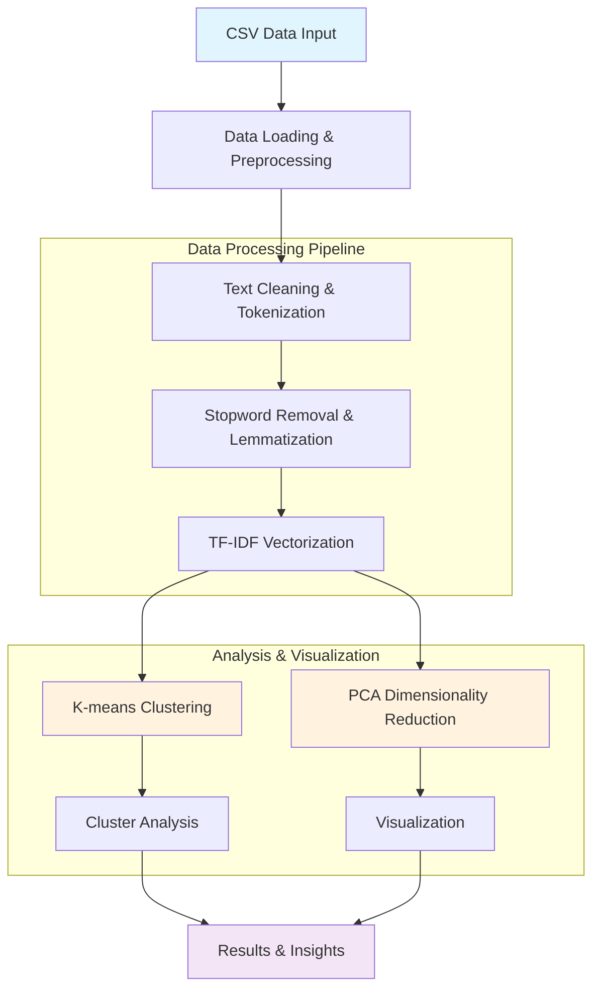

# Parliamentary Debates Text Classification

A machine learning project for analyzing and classifying European Parliament debate transcripts using Natural Language Processing (NLP) techniques and unsupervised clustering algorithms.

## 🎯 Purpose

This project analyzes European Parliament debates from 2022 to:
- Extract meaningful patterns from political discourse
- Cluster similar topics and speeches using K-means clustering
- Perform text preprocessing and feature extraction using TF-IDF vectorization
- Visualize speech clusters using dimensionality reduction (PCA)
- Provide insights into parliamentary discussion themes

## 🏗️ Architecture



## 📋 Requirements

### Python Dependencies
```
pandas>=1.5.0
numpy>=1.24.0
scikit-learn>=1.2.0
nltk>=3.8
matplotlib>=3.6.0
jupyter>=1.0.0
```

### System Requirements
- Python 3.8+
- Minimum 4GB RAM (for processing large text datasets)
- 500MB free disk space

## 🚀 Setup & Installation

### 1. Clone the Repository
```bash
git clone <repository-url>
cd parliamentary-debates-classification
```

### 2. Create Virtual Environment
```bash
# Using conda
conda create -n parl-debates python=3.9
conda activate parl-debates

# Or using venv
python -m venv venv
source venv/bin/activate  # On Windows: venv\Scripts\activate
```

### 3. Install Dependencies
```bash
pip install -r requirements.txt
```

### 4. Download NLTK Data
```python
python -c "import nltk; nltk.download('punkt'); nltk.download('stopwords'); nltk.download('wordnet')"
```

## 📊 Data Setup

1. **Obtain the dataset**: The project expects a CSV file named `debates_2022.csv` with European Parliament debates
2. **Required columns**:
   - `speaker_name`: Name of the speaker
   - `speaker_role`: Role of the speaker
   - `speaker_party`: Political party affiliation
   - `date`: Date of the debate
   - `year`: Year of the debate
   - `debate_title`: Title/topic of the debate
   - `talk_text`: The actual speech text

3. **Place the dataset** in the appropriate directory (update file paths in notebooks as needed)

## 🎮 Usage

### Running the Classification Analysis

#### Option 1: Using Jupyter Notebook (Recommended)
```bash
jupyter notebook
# Open "Classification/Parliament talks classification.ipynb"
# Run all cells sequentially
```

#### Option 2: Using Python Script
```bash
cd Classification
python Scholar.py
```

### Individual Student Submissions
The project includes individual homework submissions:
```bash
# Person 1's work
jupyter notebook "Person 1/Question_1_2_3.ipynb"
jupyter notebook "Person 1/Question_4.ipynb"

# Person 2's work
jupyter notebook "Person 2/Question_123.ipynb"
jupyter notebook "Person 2/Question_4.ipynb"

# Person 3's work
jupyter notebook "Person 3/Q_1_2_3.ipynb"
jupyter notebook "Person 3/Q_4.ipynb"
```

## 🔧 Build Instructions

### Development Setup
1. **Fork the repository** and clone your fork
2. **Set up the development environment** following the setup instructions above
3. **Install development dependencies**:
   ```bash
   pip install -r requirements-dev.txt  # If available
   ```

### Running Tests
```bash
# If tests are available
python -m pytest tests/
```

### Code Quality Checks
```bash
# Format code
black .

# Check for style issues
flake8 .

# Type checking
mypy .
```

## 📈 Features

- **Text Preprocessing**: Comprehensive cleaning pipeline including lowercasing, tokenization, stopword removal, and lemmatization
- **Feature Extraction**: TF-IDF vectorization with configurable parameters
- **Clustering Analysis**: K-means clustering with elbow method for optimal cluster selection
- **Dimensionality Reduction**: PCA for visualization of high-dimensional text data
- **Evaluation Metrics**: Silhouette score for cluster quality assessment
- **Visualization**: Scatter plots and cluster analysis charts

## 📁 Project Structure

```
.
├── Classification/
│   ├── Parliament talks classification.ipynb  # Main analysis notebook
│   ├── Scholar.py                            # Python script version
│   └── nlp/                                 # NLP utilities (if any)
├── Person 1/                               # Student 1 submissions
│   ├── Question_1_2_3.ipynb
│   ├── Question_4.ipynb
│   └── Home_work_2.pdf
├── Person 2/                               # Student 2 submissions
│   ├── Question_123.ipynb
│   ├── Question_4.ipynb
│   └── Home_work_2.pdf
├── Person 3/                               # Student 3 submissions
│   ├── Q_1_2_3.ipynb
│   ├── Q_4.ipynb
│   └── Home_work_2.pdf
├── README.md                               # This file
├── CONTRIBUTING.md                         # Contribution guidelines
└── requirements.txt                        # Python dependencies
```

## 🤝 Contributing

Please read [CONTRIBUTING.md](CONTRIBUTING.md) for details on our code of conduct and the process for submitting pull requests.

## 📝 License

This project is licensed under the MIT License - see the LICENSE file for details.

## 🙏 Acknowledgments

- European Parliament for providing the debate transcripts
- scikit-learn community for machine learning tools
- NLTK team for natural language processing utilities
- Contributors and students who worked on this project

## 📞 Support

For questions or issues:
1. Check the [Issues](../../issues) page for existing solutions
2. Create a new issue with detailed description
3. Contact the maintainers

---

**Note**: This project is for educational and research purposes. Please ensure proper attribution when using parliamentary debate data.
